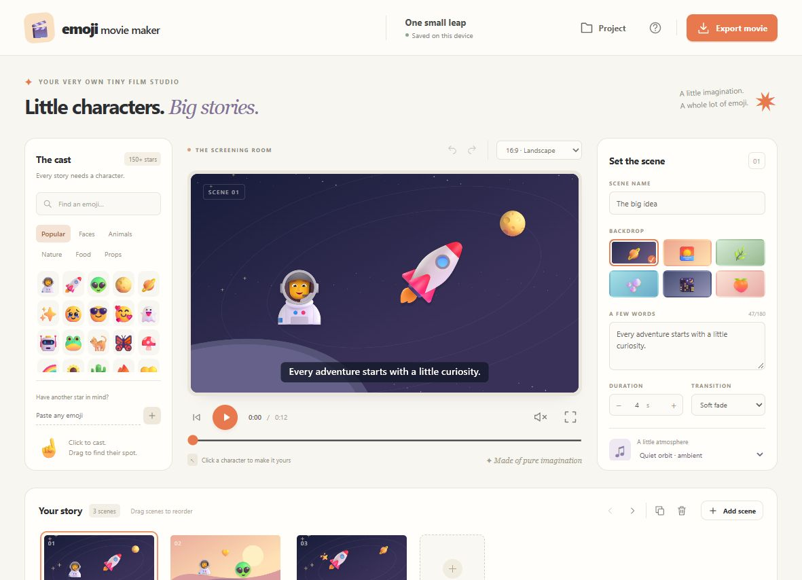

# Emoji Movie Maker

Little characters. Big stories. A browser movie studio for animated emoji adventures.



## Open the studio

[Use Emoji Movie Maker online](https://moswald14.github.io/emoji-movie-maker/).

To use it offline, download [dist/index.html](dist/index.html), then open the saved file in Chrome or Edge. The complete app is one HTML file. No installation, account, or external assets are required.

## Make a movie

1. Click an emoji to add a character, then drag it into place.
2. Choose its motion and size, pick a backdrop, and add a caption.
3. Add, duplicate, or reorder scenes and set their durations.
4. Press Play to watch your story. Turn on the speaker to hear its soundtrack.
5. Export a video, a standalone HTML movie, or an editable JSON project.

The studio includes more than 150 emoji, six backdrops, seven character motions, three optional synthesized soundtracks, undo/redo, and landscape, portrait, and square layouts. Your latest project saves in your browser; download a project file to keep a backup or continue on another device.

Video export uses the browser's recording support, usually WebM in Chrome and Edge. Recording runs in real time; keep the tab visible until it finishes. Exported HTML movies have their own player and can be shared as files. Emoji artwork varies between operating systems.

## Build and test

Node.js 18 or later is sufficient. There are no package dependencies to install.

```sh
npm run build
npm test
```

The build writes the same self-contained app to `dist/index.html` for offline use and `docs/index.html` for GitHub Pages. Pages publishes from the `main` branch's `/docs` folder; `docs/.nojekyll` preserves the static files. To also save a copy somewhere else:

```sh
node build.mjs --copy-to ./outputs/Emoji-Movie-Maker.html
```

## Project files

| File | Purpose |
| --- | --- |
| `src/engine.js` | Project validation, timing, canvas rendering, music synthesis, and WebM duration metadata |
| `src/app.js` | Editor interactions, saving, imports, and movie exports |
| `src/index.html`, `src/style.css` | Interface and responsive layouts |
| `build.mjs` | Assemble the offline HTML app |
| `tests/engine.test.cjs` | Seventeen automated checks, including online/offline build parity |
| `VALIDATION.md` | Browser verification results and limits |

The app keeps movie projects on the current device and makes no network requests.
